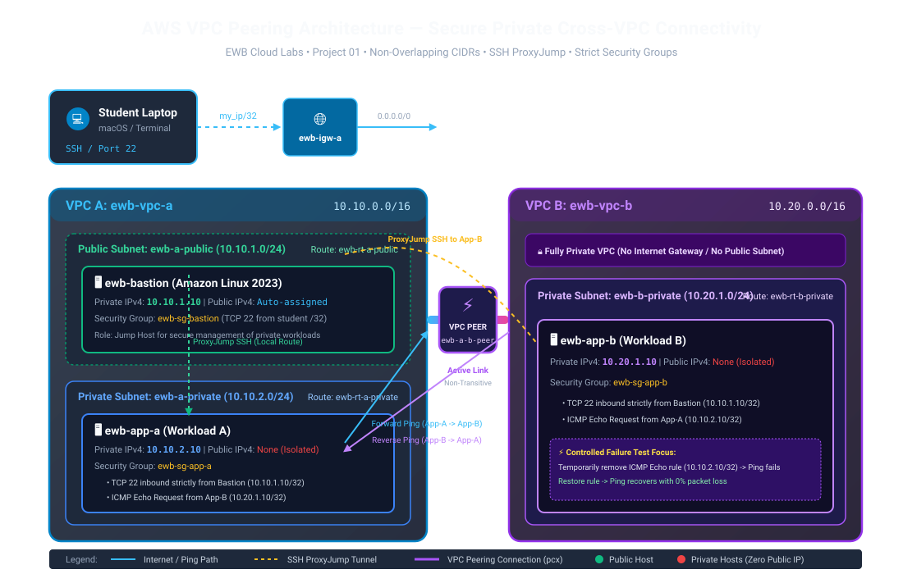

# AWS VPC Peering — Secure Private Connectivity Between Two VPCs


This repository contains the complete Infrastructure-as-Code (Terraform) project and student report template for the **EWB Courses — AWS VPC Peering Lab**.

---

## 📌 Project Overview

The objective of this project is to build and rigorously test a secure, private communication channel between two independent Virtual Private Clouds (**VPC A** and **VPC B**) on AWS. 

### Key Highlights:
- **No Internet Gateways on VPC B**: The second workload (`ewb-app-b`) is completely air-gapped from the public Internet.
- **Strict Private Isolation**: Both `ewb-app-a` and `ewb-app-b` have no public IPv4 addresses assigned.
- **Secure Management via Bastion**: Administration occurs using **SSH ProxyJump** through a hardened bastion host in VPC A. Private keys are never placed on remote instances.
- **Micro-Segmented Firewalls**: Security groups permit only specific `/32` IP addresses for SSH and ICMP Type 8 (Echo Request). `0.0.0.0/0` is never allowed for inbound access.
- **Bi-Directional Routing**: Full forward and return route configurations across the peering connection (`pcx`).

---

## 📐 Network Architecture



```
                            +--------------------------+
                            | Student Laptop (macOS)   |
                            |   SSH Key: ewb-lab.pem   |
                            +------------+-------------+
                                         | SSH Port 22 (my_ip/32)
                                         v
=====================================[ IGW A ]======================================
VPC A (10.10.0.0/16)                     |
  [Public Subnet: 10.10.1.0/24]          |
    ewb-bastion (10.10.1.10) <-----------+
        |
        | (ProxyJump Local)                 (ProxyJump Cross-VPC)
        v                                            |
  [Private Subnet: 10.10.2.0/24]                     |
    ewb-app-a (10.10.2.10)                           |
        ^                                            |
        |           ========================         |
        |           VPC PEERING (pcx-xxxxxx)         |
        +---------> [    ewb-a-b-peer      ] <-------+
                    ========================         |
=====================================================|==============================
VPC B (10.20.0.0/16) - Fully Private Workload        |
  [Private Subnet: 10.20.1.0/24]                     v
    ewb-app-b (10.20.1.10) <-------------------------+
```

---

## 📋 Addressing & Resource Plan

| Logical Name | AWS Resource Type | VPC / Subnet | IP Address / CIDR | Notes |
| :--- | :--- | :--- | :--- | :--- |
| **ewb-vpc-a** | AWS VPC | VPC A | `10.10.0.0/16` | Main VPC with Internet Access |
| **ewb-a-public** | AWS Subnet | VPC A | `10.10.1.0/24` | Houses Bastion Jump Host |
| **ewb-a-private** | AWS Subnet | VPC A | `10.10.2.0/24` | Houses App-A (Workload A) |
| **ewb-vpc-b** | AWS VPC | VPC B | `10.20.0.0/16` | Secondary Private VPC (No IGW) |
| **ewb-b-private** | AWS Subnet | VPC B | `10.20.1.0/24` | Houses App-B (Workload B) |
| **ewb-igw-a** | Internet Gateway | Attached to VPC A | N/A | Exclusively for Bastion Internet access |
| **ewb-a-b-peer** | VPC Peering Connection | Cross-VPC | Status: Active | Connects VPC A and VPC B directly |
| **ewb-bastion** | EC2 (t3.micro) | ewb-a-public | `10.10.1.10` + Public IP | Only host with a public IPv4 address |
| **ewb-app-a** | EC2 (t3.micro) | ewb-a-private | `10.10.2.10` (Private only) | Isolated backend workload A |
| **ewb-app-b** | EC2 (t3.micro) | ewb-b-private | `10.20.1.10` (Private only) | Isolated backend workload B |

---

## 🗂️ Project Repository Structure

```tree
.
├── .gitignore                      # Prevents committing secrets, state, and private keys
├── COLLEGE_ASSIGNMENT_REPORT.md   # Official college report template + Viva questions
├── DEPLOYMENT_AND_VERIFICATION.md  # Detailed step-by-step deployment & test guide
├── README.md                       # Main documentation (this file)
├── architecture_diagram.svg        # Scalable Vector Graphics architecture diagram
├── main.tf                         # VPCs, Subnets, Route Tables, Peering, SGs, EC2s
├── outputs.tf                      # Resource IDs, IPs, and ready-to-use SSH configs
├── terraform.tfvars.example        # Example input parameters (Safe to share)
├── variables.tf                    # Variable declarations with validation rules
└── versions.tf                     # Provider and Terraform version constraints
```

---

## 🚀 Quick Start on macOS

### 1. Configure AWS CLI & Permissions
```bash
aws configure
chmod 600 ~/.aws/credentials ~/.aws/config
```

### 2. Configure Your Variables
Find your workstation's public IP and set it in `terraform.tfvars`:
```bash
# Obtain your IP
curl -s https://checkip.amazonaws.com

# Copy example config
cp terraform.tfvars.example terraform.tfvars
```
Update `terraform.tfvars`:
```hcl
aws_region   = "ap-south-1"        # e.g., Mumbai
student_name = "YourName"
my_ip        = "YOUR_PUBLIC_IP/32" # Must be single IP host /32
key_name     = "ewb-lab"
```

### 3. Initialize & Deploy with Terraform
```bash
terraform init
terraform fmt -check
terraform validate
terraform plan -out=tfplan
terraform apply tfplan
```

### 4. Configure Local SSH on macOS
Terraform outputs a formatted SSH configuration. Append it to `~/.ssh/config`:
```bash
terraform output -raw ssh_config_snippet >> ~/.ssh/config
chmod 600 ~/.ssh/config
```

---

## 🧪 Verification & Acceptance Tests

| Step | Location | Command | Expected Result |
| :--- | :--- | :--- | :--- |
| **Test 01 / Baseline** | App-A (before routes) | `ping -c 4 10.20.1.10` | 100% packet loss (no replies) |
| **Test 02 / Forward Ping** | App-A (after routes) | `ping -c 4 10.20.1.10` | 4 packets received, 0% loss |
| **Test 03 / Reverse Ping** | App-B (after routes) | `ping -c 4 10.10.2.10` | 4 packets received, 0% loss |
| **Test 04 / Private SSH** | Student Laptop | `ssh ewb-app-b` | Direct shell to App-B via ProxyJump |
| **Test 05 / Isolation Audit** | AWS CLI / Console | Inspect App-A & App-B | Public IPv4 is completely blank (`None`) |
| **Test 06 / Controlled Failure**| App-B SG Rule dropped | `ping -c 4 10.20.1.10` | Ping fails; restores upon rule re-addition |

For detailed execution procedures, refer to [DEPLOYMENT_AND_VERIFICATION.md](file:///Users/apple/Desktop/ml%20program/aws%20project/DEPLOYMENT_AND_VERIFICATION.md).

---

## 🎓 College Assignment Report

A complete submission template adhering to the EWB project scoring criteria (100 Marks) is available in [COLLEGE_ASSIGNMENT_REPORT.md](file:///Users/apple/Desktop/ml%20program/aws%20project/COLLEGE_ASSIGNMENT_REPORT.md). It includes:
- Architecture and inventory tables
- Route table and security rules breakdown
- Test results recording matrix with screenshot placeholders
- Controlled failure and recovery analysis
- 6 comprehensive Viva Voce questions with model answers
- Teardown verification checklist

---

## 🧹 Teardown & Cost Management

Always destroy lab resources when you complete testing:
```bash
terraform destroy
```
Confirm with `yes` to cleanly remove all EC2 instances, EBS volumes, security groups, route tables, peering links, and VPCs.
